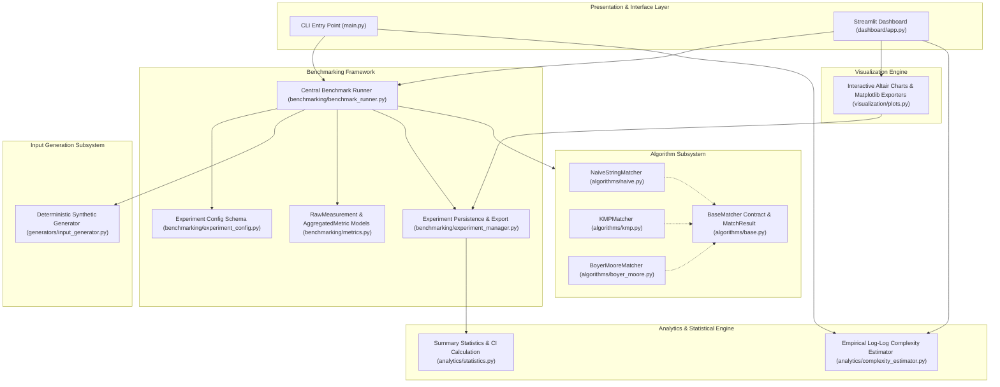
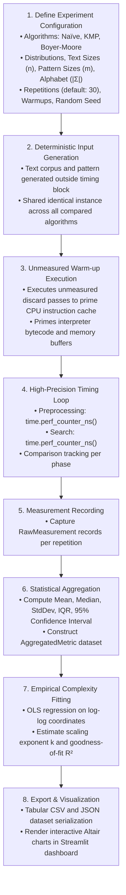

# MatchLab

An empirical benchmarking and complexity analysis platform for classical string-matching algorithms.

[](https://www.python.org/)
[](tests/)
[](dashboard/app.py)
[](.)
[](../LICENSE)

---

## Table of Contents

- [Overview](#overview)
- [Key Features](#key-features)
- [System Architecture](#system-architecture)
- [Implemented Algorithms & Complexity](#implemented-algorithms--complexity)
  - [Naïve String Matching](#1-naïve-string-matching)
  - [Knuth-Morris-Pratt (KMP)](#2-knuth-morris-pratt-kmp)
  - [Boyer-Moore](#3-boyer-moore)
  - [Theoretical Complexity Summary](#theoretical-complexity-summary)
- [Experimental Methodology](#experimental-methodology)
- [Input Generation & Dataset Distributions](#input-generation--dataset-distributions)
- [Performance Metrics & Statistical Evaluation](#performance-metrics--statistical-evaluation)
- [Empirical Complexity Estimation](#empirical-complexity-estimation)
  - [Mathematical Formulation](#mathematical-formulation)
  - [Regression Robustness & Edge-Case Safeguards](#regression-robustness--edge-case-safeguards)
  - [Empirical Growth Classification](#empirical-growth-classification)
  - [Theoretical Asymptotic Bounds vs. Empirical Scaling](#theoretical-asymptotic-bounds-vs-empirical-scaling)
- [Interactive Dashboard & Visualization](#interactive-dashboard--visualization)
- [Project Structure](#project-structure)
- [Installation & Setup](#installation--setup)
- [Execution Guide](#execution-guide)
  - [Automated Test Suite](#1-automated-test-suite)
  - [Algorithmic Demonstration](#2-algorithmic-demonstration)
  - [Parametric Benchmark Sweep](#3-parametric-benchmark-sweep)
  - [Interactive Analysis Dashboard](#4-interactive-analysis-dashboard)
- [Reproducibility & Data Serialization](#reproducibility--data-serialization)
- [Engineering Decisions & Practical Limitations](#engineering-decisions--practical-limitations)
- [Future Scope](#future-scope)
- [License](#license)

---

## Overview

Exact string matching is a foundational problem in computer science with applications spanning computational genomics, search indexers, network intrusion detection systems (NIDS), and textual retrieval engines. While asymptotic analysis establishes theoretical upper and lower bounds on matching efficiency, real-world algorithmic execution depends heavily on alphabet cardinality, pattern length, structural redundancy, CPU caching, and memory hierarchy characteristics.

**MatchLab** is an empirical performance analysis platform designed to experimentally measure, benchmark, and compare three classical exact pattern-matching algorithms:
1. **Naïve (Brute-Force) String Matching**
2. **Knuth-Morris-Pratt (KMP)**
3. **Boyer-Moore** (Bad Character Rule and Strong Good Suffix Rule)

### The Scientific Approach

MatchLab treats algorithm evaluation as an empirical experimental science rather than a purely theoretical exercise:
- **Character Comparisons vs. Wall-Clock Time**: Wall-clock execution time is subject to operating system scheduling, background processes, memory bus saturation, and interpreter dispatch overhead. To isolate algorithmic behavior from host noise, MatchLab instruments each algorithm to deterministically count character comparisons alongside nanosecond timing.
- **Phase Separation**: Preprocessing overhead is isolated from the actual search loop. This reveals exact breakeven points where precomputed index tables overcome brute-force scanning costs.
- **Parametric Stress Testing**: Algorithms are evaluated across 11 systematic input distributions—including uniform random text, highly repetitive periodic patterns, best-case sublinear configurations, and adversarial repetitive-prefix cases that degrade naïve search to quadratic time.

> [!NOTE]
> **Benchmarking vs. Machine Learning Evaluation**: MatchLab evaluates deterministic exact pattern-matching algorithms under algorithmic efficiency metrics (character comparisons, preprocessing duration, search runtime, and empirical scaling exponents). It does not compute predictive machine learning metrics such as accuracy, precision, recall, or F1 score, because all implemented algorithms guarantee 100% exact match recall across all valid inputs.

---

## Key Features

- **Strict Algorithmic Implementations**: Independent, modular implementations of Naïve, KMP, and Boyer-Moore conforming to a shared `BaseMatcher` interface.
- **Fine-Grained Instrumentation**: Character comparisons tracked independently across both preprocessing and search execution phases.
- **High-Precision Timing**: Execution profiled using `time.perf_counter_ns()` with microsecond-level accuracy.
- **Controlled Experimental Engine**: Warm-up cycles to eliminate JIT/cache cold-start anomalies; identical generated inputs shared across all algorithms to ensure fair comparison.
- **11 Input Distributions**: Configurable corpus and pattern generation covering uniform random, periodic, repetitive, best-case, absent, adversarial prefix, and positional alignments.
- **Statistical Aggregation**: Default 30 repetitions per parameter point computing mean, median, standard deviation, minimum, maximum, interquartile range (IQR), and 95% confidence intervals.
- **Empirical Complexity Estimator**: Log-log ordinary least squares (OLS) regression ($\log(T(n)) = \log(c) + k \cdot \log(n)$) estimating empirical scaling exponents ($k$) with domain variance and non-positive value safeguards.
- **Interactive Presentation Layer**: Monochromatic, data-dense Streamlit dashboard incorporating interactive Altair plots and publication-ready Matplotlib export routines.
- **Comprehensive Verification**: 109 Pytest unit, property-based, and correctness tests validating behavior against Python's native string matching ground truth.
- **Dual Serialization Formats**: Export capability producing structured CSV and JSON outputs for both raw repetitions and aggregated metrics.

---

## System Architecture

MatchLab enforces a decoupled, modular architecture where algorithms, data generators, benchmarking harnesses, analytical engines, and visualization modules remain strictly independent.



### Experiment Execution Workflow

The following sequence illustrates the lifecycle of a benchmark experiment from parameter definition to analytical presentation:



---

## Implemented Algorithms & Complexity

MatchLab provides three fully independent algorithm implementations inheriting from `BaseMatcher`. Each algorithm accepts corpus `text` and query `pattern`, tracks character comparisons across preprocessing and search phases, and returns an immutable `MatchResult`.

### 1. Naïve String Matching
- **Implementation**: [`algorithms/naive.py`](algorithms/naive.py)
- **Mechanism**: Slides a window of length $m$ over the text from index $0$ to $n - m$. At each alignment, characters are compared from left to right. On a mismatch, the pattern shifts by $1$ and resets the comparison pointer.
- **Preprocessing**: None ($O(1)$ time, $0$ comparisons, $O(1)$ space).
- **Best Case**: $O(n)$ comparisons when the first character mismatches on every slide (e.g., text `AAAAA`, pattern `BA`).
- **Worst Case**: $O((n - m + 1) \cdot m)$ comparisons when almost all pattern characters match before a mismatch occurs at the final character (e.g., text `AAAAAAA...`, pattern `AAAAB`).
- **Overlapping Matches**: Supported by advancing the shift by $1$ following a full match.

### 2. Knuth-Morris-Pratt (KMP)
- **Implementation**: [`algorithms/kmp.py`](algorithms/kmp.py)
- **Mechanism**: Eliminates redundant comparisons by exploiting the pattern's internal periodic structure. Constructing the Longest Proper Prefix which is also a Suffix (LPS / $\pi$) table allows the algorithm to determine how far the pattern pointer $j$ can slide forward without ever regressing the text pointer $i$.
- **Preprocessing**: $O(m)$ time and space; at most $2m$ comparisons during LPS construction.
- **Search Complexity**: Guaranteed strict $O(n)$ search time and at most $2n$ comparisons, regardless of text degeneracy or repetition.
- **Total Time**: $O(n + m)$.
- **Overlapping Matches**: Supported by transitioning to $j = \text{lps}[j - 1]$ upon detecting a match.

### 3. Boyer-Moore
- **Implementation**: [`algorithms/boyer_moore.py`](algorithms/boyer_moore.py)
- **Variant Details**: Classical Boyer-Moore implementing:
  1. **Extended Bad Character Rule**: Rightmost occurrence dictionary mapping each character to its rightmost 0-based index in the pattern. On a mismatch at index $j$ with text character $c$, the suggested shift is `max(1, j - last_pos[c])`.
  2. **Strong Good Suffix Rule**: Precomputed using Gusfield's $N$-array derived from the fundamental Z-algorithm on the reversed pattern string. Correctly differentiates between:
     - *Case 1*: An identical substring occurring elsewhere in the pattern preceded by a character distinct from the mismatched character.
     - *Case 2*: The longest proper prefix of the pattern that matches a suffix of the matched substring.
  3. **Right-to-Left Scanning**: At each shift alignment $s$, characters are checked from pattern position $m - 1$ down to $0$.
  4. **Full Match Shift**: Upon finding a full match, the window shifts by `m - longest_proper_border`, guaranteeing complete detection of overlapping occurrences.
- **Worst-Case Complexity Note**: This implementation is classical Boyer-Moore without the Galil rule or Apostolico-Crochemore match memory. Consequently, its worst-case search complexity on highly periodic strings is $O(n \cdot m)$. On non-periodic strings or when patterns are absent, search complexity is $O(n + m)$.
- **Best-Case Complexity**: Sublinear $O(n / m)$ when text characters do not exist in the pattern, skipping $m$ text positions per comparison.

### Theoretical Complexity Summary

| Algorithm | Preprocessing Time | Preprocessing Space | Preprocessing Comparisons | Search Time (Best) | Search Time (Average) | Search Time (Worst) | Search Comparisons (Worst) | Invariant / Shift Mechanism |
| :--- | :---: | :---: | :---: | :---: | :---: | :---: | :---: | :--- |
| **Naïve** | $O(1)$ | $O(1)$ | $0$ | $O(n)$ | $O(n)$ | $O((n - m + 1) \cdot m)$ | $(n - m + 1) \cdot m$ | Slide window by $1$; resets text pointer on mismatch |
| **KMP** | $O(m)$ | $O(m)$ | $\le 2m$ | $O(n)$ | $O(n)$ | $O(n)$ | $\le 2n$ | Never regresses text pointer $i$; shifts pattern pointer $j$ via LPS table |
| **Boyer-Moore** | $O(m + |\Sigma|)$ | $O(m + |\Sigma|)$ | Z-algorithm on reversed pattern | $O(n / m)$ | $O(n / m)$ | $O(n \cdot m)^*$ | $(n - m + 1) \cdot m$ | Scans right-to-left; shifts by $\max(\text{BadChar}, \text{GoodSuffix})$ |

*\* Without Galil match memory optimizations on periodic patterns.*

---

## Experimental Methodology

To obtain scientifically rigorous and reproducible benchmark measurements, MatchLab enforces six core experimental controls:

1. **Measurement Window Isolation**: All synthetic string generation, object allocation, table initialization, plotting, and file I/O take place strictly outside timed code blocks.
2. **Nanosecond Timer Precision**: Execution elapsed time is captured using `time.perf_counter_ns()`. Floating-point conversion to seconds or milliseconds occurs exclusively during post-run data aggregation.
3. **Execution Phase Decomposition**: Preprocessing duration and character comparisons are isolated from the search loop:
   $$T_{\text{total}} = T_{\text{preprocessing}} + T_{\text{search}}$$
   $$C_{\text{total}} = C_{\text{preprocessing}} + C_{\text{search}}$$
4. **Controlled Input Sharing**: For any evaluation point $(distribution, n, m, |\Sigma|)$, the identical generated corpus text and pattern instance is evaluated across all active algorithms.
5. **Instruction Cache & Warm-Up Passes**: Configurable unmeasured warm-up iterations precede timed runs to prime CPU instruction caches, memory prefetchers, and Python bytecode caches.
6. **Central Limit Theorem Compliance**: Full benchmark experiments collect 30 independent repetitions per parameter configuration by default. This satisfies sample size criteria for robust parametric estimation of means, variances, and 95% confidence intervals.

---

## Input Generation & Dataset Distributions

The synthetic data generation subsystem ([`generators/input_generator.py`](generators/input_generator.py)) provides deterministic dataset construction across 11 distinct input distributions:

| Distribution Identifier | Generator Logic | Algorithmic Evaluation Purpose |
| :--- | :--- | :--- |
| `random` | Uniform random characters selected independently for text and pattern over alphabet $\Sigma$. | Standard baseline across realistic entropy conditions. |
| `random_with_match` | Uniform random text with a slice of length $m$ extracted as the search pattern. | Guarantees at least one valid natural occurrence. |
| `repetitive` | Uniform single character repeated across text and pattern ($T = \text{'A'}^n, P = \text{'A'}^m$). | Dense overlapping matches; evaluates maximum shift density. |
| `periodic` | Repetitive periodic sequence ($T = (\text{'AB'})^{\lceil n/2 \rceil}, P = (\text{'AB'})^{\lceil m/2 \rceil}$). | Evaluates prefix/suffix table utilization under regular periodicity. |
| `best_case` | Completely disjoint character sets ($T = \text{'A'}^n, P = \text{'B'}^m$). | Triggers optimal $O(n/m)$ sublinear skipping in Boyer-Moore. |
| `adversarial_prefix` | Text $T = \text{'A'}^n$, Pattern $P = \text{'A'}^{m-1}\text{'B'}$. | Worst-case input: forces Naïve to perform $m$ comparisons per slide, degrading to quadratic time. |
| `absent` | Pattern alphabet partitioned disjointly from text alphabet. | Evaluates full text traversals where pattern does not exist. |
| `match_at_start` | Pattern embedded strictly at index $0$; rest of text composed of disjoint characters. | Measures early-exit search and shift behavior. |
| `match_at_middle` | Pattern embedded at index $\lfloor (n - m)/2 \rfloor$; surrounding characters disjoint. | Measures mid-corpus detection latency. |
| `match_at_end` | Pattern embedded at index $n - m$; prefix text characters disjoint. | Measures full traversal cost preceding match detection. |
| `overlapping` | Identical character sequences ($T = \text{'A'}^n, P = \text{'A'}^m$). | Tests overlapping match recall and border shift efficiency. |

### Configurable Alphabet Pools

Alphabet size is dynamically managed via `get_alphabet_by_size(size)`:
- `size = 2`: Binary alphabet (`"01"`).
- `size = 4`: DNA nucleotide alphabet (`"ACGT"`).
- `size = 26`: Lowercase ASCII alphabet (`"a-z"`).
- `size = 52`: Case-sensitive alphanumeric letters (`"a-zA-Z"`).
- `size > 52`: Deterministic printable ASCII and Latin-1 character pools.

---

## Performance Metrics & Statistical Evaluation

MatchLab captures fine-grained metrics for each trial repetition and computes descriptive summary statistics.

### Captured Metric Inventory

| Metric Field | Level | Units | Description |
| :--- | :---: | :---: | :--- |
| `preprocessing_time_ns` / `seconds` | Raw | $\text{ns} \ / \ \text{s}$ | Elapsed time constructing algorithm lookup tables. |
| `search_time_ns` / `seconds` | Raw | $\text{ns} \ / \ \text{s}$ | Elapsed time scanning corpus text. |
| `total_time_ns` / `seconds` | Raw | $\text{ns} \ / \ \text{s}$ | Total execution latency ($\text{preprocessing} + \text{search}$). |
| `preprocessing_comparisons` | Raw | Count | Character comparisons executed during preprocessing. |
| `search_comparisons` | Raw | Count | Character comparisons executed during search scanning. |
| `total_comparisons` | Raw | Count | Total character comparisons evaluated. |
| `match_count` | Raw | Count | Total verified occurrences found in the corpus. |
| `mean_search_time_seconds` | Aggregated | Seconds | Arithmetic mean of search runtimes across repetitions. |
| `median_search_time_seconds` | Aggregated | Seconds | Median search runtime (robust against system latency spikes). |
| `std_search_time_seconds` | Aggregated | Seconds | Sample standard deviation of search runtimes. |
| `min_search_time` / `max_search_time` | Aggregated | Seconds | Observed range of search execution durations. |
| `mean_search_comparisons` | Aggregated | Count | Expected character comparisons during search. |
| `mean_throughput_chars_per_sec` | Aggregated | $\text{chars/s}$ | Processing throughput: $n / \bar{t}_{\text{search}}$ characters per second. |

### Statistical Aggregation Module

The statistical module ([`analytics/statistics.py`](analytics/statistics.py)) provides standard aggregation:
- **Central Tendency**: Mean and Median.
- **Dispersion**: Standard Deviation and Sample Variance.
- **Percentiles & Spread**: Minimum, Maximum, 25th percentile ($P_{25}$), 75th percentile ($P_{75}$), and Interquartile Range ($\text{IQR} = P_{75} - P_{25}$).
- **Confidence Intervals**: 95% Confidence Interval for the mean using standard error:
  $$\text{SE} = \frac{s}{\sqrt{N}}, \quad \text{CI}_{95} = \bar{x} \pm 1.96 \cdot \text{SE}$$

---

## Empirical Complexity Estimation

While theoretical complexity is derived through mathematical induction on abstract models of computation, empirical complexity estimates observed scaling behavior on physical hardware.

### Mathematical Formulation

MatchLab models empirical growth through power-law scaling:
$$T(n) \approx c \cdot n^k$$

Applying a logarithmic transformation converts this relation into a linear equation:
$$\log(T(n)) = \log(c) + k \cdot \log(n)$$

Let $x_i = \log(n_i)$ and $y_i = \log(T(n_i))$. The empirical scaling exponent $k$ (the slope) and constant prefactor $c$ are estimated via Ordinary Least Squares (OLS) regression:

$$k = \frac{\sum_{i=1}^N (x_i - \bar{x})(y_i - \bar{y})}{\sum_{i=1}^N (x_i - \bar{x})^2}, \quad \log(c) = \bar{y} - k \cdot \bar{x}, \quad c = e^{\log(c)}$$

Goodness of fit is evaluated through the coefficient of determination ($R^2$):
$$R^2 = 1 - \frac{\sum_{i=1}^N (y_i - \hat{y}_i)^2}{\sum_{i=1}^N (y_i - \bar{y})^2}$$

Standard error of the estimated exponent is computed when $N > 2$:
$$s_{\text{res}} = \sqrt{\frac{\sum_{i=1}^N (y_i - \hat{y}_i)^2}{N - 2}}, \quad \text{SE}(k) = \frac{s_{\text{res}}}{\sqrt{\sum_{i=1}^N (x_i - \bar{x})^2}}$$

### Regression Robustness & Edge-Case Safeguards

The complexity estimator ([`analytics/complexity_estimator.py`](analytics/complexity_estimator.py)) includes three numerical safeguards:
1. **Zero and Negative Value Filtering**: Any measurement where $n \le 0$ or $T(n) \le 0$ is filtered out prior to logarithmic transformation, preventing mathematical domain errors.
2. **Insufficient Sample Detection**: If fewer than 2 valid positive data points are available, regression terminates safely and returns `valid=False` with an `Insufficient Data` warning.
3. **Degenerate Domain Protection**: If variance in input size is negligible ($\text{Var}(\log(n)) < 10^{-12}$, e.g. when all trials use the same text length), the estimator prevents division by zero and flags a `Degenerate Domain` condition.

### Empirical Growth Classification

Estimated exponents ($k$) map to descriptive empirical complexity categories:
- $k < 0.2$: **Empirical Sublinear / Constant**
- $0.8 \le k \le 1.2$: **Empirical Linear**
- $1.2 < k \le 1.4$: **Empirical Superlinear**
- $1.8 \le k \le 2.2$: **Empirical Quadratic**
- All other values: **Empirical Polynomial** ($k \approx \text{value}$)

### Theoretical Asymptotic Bounds vs. Empirical Scaling

> [!IMPORTANT]
> **Asymptotic Bounds vs. Empirical Scaling**:
> - **Theoretical Asymptotic Complexity** ($O, \Omega, \Theta$) characterizes limiting behavior as $n \to \infty$ on an idealized Turing machine or RAM model. It purposefully abstracts away constant factors, hardware memory latency, and cache hierarchy effects.
> - **Empirical Complexity Estimation** calculates observed wall-clock or comparison scaling over a finite experimental interval $[n_{\min}, n_{\max}]$. Observed exponents reflect physical system realities: L1/L2/L3 CPU cache residency, cache line misses, interpreter dispatch loops, and branch mispredictions. An algorithm with superior asymptotic bounds may demonstrate higher concrete runtime on small inputs due to initialization constant factors.

---

## Interactive Dashboard & Visualization

MatchLab provides a scientific Streamlit analysis dashboard ([`dashboard/app.py`](dashboard/app.py)) styled after modern engineering developer tools (monochromatic theme, high information density, zero decorative animations).

```
+-----------------------------------------------------------------------------------------------+
|  MatchLab Analysis Platform                                                                   |
|  Empirical Evaluation and Complexity Analysis: Naïve, Knuth-Morris-Pratt, and Boyer-Moore     |
+-----------------------------------------------------------------------------------------------+
| [ Overview ]  [ Benchmark Lab ]  [ Algorithm Comparison ]  [ Complexity Analysis ]  [ Results ]|
+-----------------------------------------------------------------------------------------------+
```

### Visual Interface Sections

1. **Overview**: Executive performance summary:
   - Fastest algorithm in current parameter context.
   - Median search runtime across parameter sweeps.
   - Cumulative character comparison count.
   - Preprocessing overhead ratio.
   - Experiment provenance details (Experiment ID, UTC timestamp, seed, repetition count).
2. **Benchmark Lab**: Parametric configuration control panel:
   - Multiselect controls for algorithms, input distributions, and alphabet sizes ($|\Sigma|$).
   - Comma-delimited text inputs for text lengths ($n$) and pattern lengths ($m$).
   - Repetition slider (default: 30) and deterministic random seed input.
   - One-click experiment execution trigger.
3. **Algorithm Comparison**: Interactive Altair analytical graphs:
   - Search runtime vs. corpus length ($n$).
   - Character comparisons vs. corpus length ($n$).
   - Preprocessing vs. search phase comparison breakdown bar chart.
   - Distribution sensitivity comparison across algorithms.
   - Runtime scaling as a function of pattern length ($m$).
4. **Complexity Analysis**: Log-log OLS power-law regression panel:
   - Tabular presentation of comparison and runtime exponents ($k$) with $R^2$ values.
   - Interactive log-log scatter plot with fitted regression lines.
   - Contextual analysis explaining empirical vs. asymptotic performance.
5. **Results Explorer**: Tabular data exploration interface:
   - Multi-dimensional filters (algorithm, distribution, $n$, $m$).
   - Dual-tab inspection for aggregated summary metrics and raw trial repetitions.
   - Direct download buttons for CSV and JSON datasets.

### Dashboard Preview

<!-- Screenshot placeholders: Add actual application captures here -->
```
+-----------------------------------------------------------------------------------------+
| [Screenshot Placeholder: MatchLab Overview & KPI Panels]                                |
| Displays summary metrics, execution provenance, and contextual algorithmic notes.       |
+-----------------------------------------------------------------------------------------+
| [Screenshot Placeholder: Interactive Scaling Charts & Regression Lines]                 |
| Visualizes Altair runtime curves, character comparisons, and log-log power-law fits.    |
+-----------------------------------------------------------------------------------------+
```

### Visual Palette Standards

Charts adhere to a high-contrast, accessible categorical palette:
- **Naïve**: Crimson (`#dc2626`)
- **KMP**: Cobalt (`#2563eb`)
- **Boyer-Moore**: Emerald (`#059669`)
- **Preprocessing Phase**: Amber (`#f59e0b`)
- **Search Phase**: Blue (`#3b82f6`)

---

## Project Structure

```
MatchLab/
├── algorithms/                  # Core algorithmic engine
│   ├── base.py                  # BaseMatcher ABC & MatchResult dataclass
│   ├── naive.py                 # Naïve sliding-window string matcher
│   ├── kmp.py                   # Knuth-Morris-Pratt matcher with LPS construction
│   ├── boyer_moore.py           # Boyer-Moore matcher (Bad Character & Strong Good Suffix)
│   └── __init__.py
├── generators/                  # Reproducible dataset generation subsystem
│   ├── input_generator.py       # 11 input distributions & dynamic alphabet generator
│   └── __init__.py
├── benchmarking/                # Controlled benchmarking harness
│   ├── experiment_config.py     # ExperimentConfig schema (default: 30 repetitions)
│   ├── metrics.py               # RawMeasurement & AggregatedMetric models
│   ├── experiment_manager.py    # Experiment persistence & CSV/JSON serialization
│   ├── benchmark_runner.py      # Runner: warm-up passes, perf_counter_ns, shared inputs
│   └── __init__.py
├── analytics/                   # Mathematical & statistical analysis
│   ├── statistics.py            # Summary statistics (mean, median, stdev, IQR, 95% CI)
│   ├── complexity_estimator.py  # Log-log OLS regression: log(T(n)) = log(c) + k * log(n)
│   └── __init__.py
├── visualization/               # Presentation & charting layer
│   ├── plots.py                 # Interactive Altair builders & static Matplotlib exports
│   └── __init__.py
├── dashboard/                   # Scientific Streamlit dashboard
│   └── app.py                   # Multi-tab analytical interface
├── tests/                       # Pytest test suite (109 passing tests)
│   ├── test_naive.py            # Naïve unit, edge case, and comparison tests
│   ├── test_kmp.py              # KMP unit, LPS table, and linear search tests
│   ├── test_boyer_moore.py      # Boyer-Moore heuristics and sublinear tests
│   ├── test_generators.py       # Input generator validation and distribution tests
│   ├── test_correctness.py      # Ground-truth property tests against Python str.find
│   ├── test_benchmark_engine.py # Benchmark runner, metrics, and manager tests
│   └── test_visualization.py    # Chart builders and export routine tests
├── experiments/                 # Storage directory for experiment configurations
├── results/                     # Default output directory for CSV/JSON exports
├── main.py                      # Command-line interface entry point
├── requirements.txt             # Project dependencies
└── pytest.ini                  # Pytest configuration
```

---

## Installation & Setup

### Prerequisites

- **Python**: Version 3.10 or higher.
- **Operating System**: Windows, macOS, or Linux.

### Installation Procedure

1. **Clone the repository**:
   ```bash
   git clone https://github.com/your-username/MatchLab.git
   cd MatchLab
   ```

2. **Create and activate a virtual environment**:
   ```bash
   # On macOS / Linux
   python3 -m venv venv
   source venv/bin/activate

   # On Windows (PowerShell)
   python -m venv venv
   .\venv\Scripts\Activate.ps1
   ```

3. **Install dependencies**:
   ```bash
   pip install -r requirements.txt
   ```

---

## Execution Guide

### 1. Automated Test Suite

Execute the full suite of 109 automated tests to verify algorithmic correctness, edge-case coverage, and benchmarking stability:

```bash
pytest -v
```

To run a specific test module:
```bash
pytest tests/test_correctness.py -v
```

### 2. Algorithmic Demonstration

Run a quick terminal demonstration evaluating Naïve, KMP, and Boyer-Moore across natural DNA, dense overlapping, and adversarial inputs:

```bash
python main.py --demo
```

Sample CLI output:
```
================================================================================
                 MatchLab: Empirical Algorithm Comparison Demo                  
================================================================================

Scenario: Natural DNA Sequence
  Text (n=44):    GCATATCGCATATAGCATATCGGCATATCGCATATCGCATATA
  Pattern (m=7): GCATATC
--------------------------------------------------------------------------------
Algorithm       | Matches  | Prep Comps | Search Comps | Total Comps | Time (ms)
--------------------------------------------------------------------------------
Naive           | 4        | 0          | 47           | 47          | 0.024    
KMP             | 4        | 7          | 49           | 56          | 0.038    
Boyer-Moore     | 4        | 7          | 26           | 33          | 0.045    
--------------------------------------------------------------------------------
```

### 3. Parametric Benchmark Sweep

Execute a systematic benchmark sweep over a specific input distribution with automated dataset serialization:

```bash
# Run 30 repetitions across the uniform random distribution
python main.py --benchmark random --repetitions 30 --export-dir results

# Run an adversarial prefix sweep to demonstrate Naïve degradation
python main.py --benchmark adversarial_prefix --repetitions 15 --export-dir results
```

CLI options:
- `--benchmark [DISTRIBUTION]`: Target distribution (`random`, `repetitive`, `periodic`, `best_case`, `adversarial_prefix`, `absent`, etc.).
- `--repetitions [INT]`: Number of independent repetitions per configuration point (default: 30).
- `--export-dir [PATH]`: Destination folder for exported CSV and JSON files (default: `results`).

### 4. Interactive Analysis Dashboard

Launch the Streamlit dashboard in your web browser:

```bash
streamlit run dashboard/app.py
```

The application will launch on `http://localhost:8501`.

---

## Reproducibility & Data Serialization

MatchLab is engineered for end-to-end experimental reproducibility:
- **Deterministic Pseudo-Random Seeds**: Every synthetic dataset generation run accepts an explicit integer seed. Re-executing an experiment with the identical configuration and seed reproduces the exact same text and pattern inputs.
- **Provenance Tracking**: Every measurement record includes its `experiment_id`, `timestamp` (ISO 8601 UTC), `seed`, `distribution`, and full parameter tuple $(n, m, |\Sigma|)$.
- **Tabular Data Serialization**: The `ExperimentManager` ([`benchmarking/experiment_manager.py`](benchmarking/experiment_manager.py)) exports results in standardized tabular formats:
  - `raw_measurements_<ID>.csv`: Every individual repetition record with nanosecond timing and comparison counters.
  - `raw_measurements_<ID>.json`: Raw records structured as JSON documents.
  - `aggregated_metrics_<ID>.csv`: Post-run aggregated summary statistics (means, medians, standard deviations, min, max, throughput).
  - `aggregated_metrics_<ID>.json`: Aggregated metrics formatted for machine consumption.

---

## Engineering Decisions & Practical Limitations

### Architectural Decisions

1. **Explicit Comparison Counters vs. Operator Overloading**:
   - *Decision*: Track comparisons via explicit counter variables in search loops rather than wrapping characters in custom comparison-logging classes.
   - *Rationale*: Operator overloading in Python introduces substantial method dispatch overhead (approx. 5–10× slowdown per comparison), heavily distorting wall-clock measurements. Direct counters preserve realistic loop execution dynamics.
2. **Nanosecond Timing Resolution**:
   - *Decision*: Profile using `time.perf_counter_ns()` instead of `time.time()`.
   - *Rationale*: Sub-millisecond string searches on short inputs require integer nanosecond resolution to avoid precision loss and zero-duration measurement artifacts.
3. **Decoupled Presentation Layer**:
   - *Decision*: Keep Streamlit and visualization modules strictly separate from the core algorithm and benchmarking engines.
   - *Rationale*: Allows headless execution in automated continuous integration (CI) environments and command-line benchmarking without GUI dependencies.

### Practical Limitations of Runtime Benchmarking

When interpreting empirical runtime metrics, engineers must consider practical execution factors:

1. **Hardware Memory Hierarchy & Cache Residency**: Real processors feature multi-level cache hierarchies (L1, L2, L3). Inputs that fit within the L1 data cache ($\approx 32\text{ KB}$) experience negligible memory access latency. Corpora that exceed L3 cache capacity induce main memory bus stalls and page faults, which can distort empirical scaling curves independently of algorithmic efficiency.
2. **CPython Interpreter Overhead**: In an interpreted runtime, bytecode dispatch and loop iteration overhead can overshadow raw algorithmic differences on small inputs ($n < 500$). The constant prefactors measured in Python will differ from those observed in compiled C or Rust implementations.
3. **Branch Prediction Effects**: Highly repetitive and periodic inputs benefit from CPU branch predictors, executing loop iterations faster per comparison than high-entropy random sequences.
4. **Finite Parameter Domains vs. Asymptotic Behavior**: Empirical regression models scaling over a finite experimental range $[n_{\min}, n_{\max}]$. While valuable for understanding practical performance within target bounds, it cannot guarantee asymptotic behavior as $n \to \infty$.

---

## Future Scope

Potential architectural and algorithmic extensions for MatchLab:

- **Additional Classical Algorithms**:
  - Aho-Corasick automaton for simultaneous multi-pattern matching.
  - Rabin-Karp rolling hash algorithm.
  - Bit-parallel matching algorithms (Baeza-Yates-Gonnet Shift-Or / Bitap).
  - Two-Way string matching algorithm.
- **Hardware Acceleration Profiles**:
  - SIMD vectorization benchmarks comparing scalar loops against AVX2/AVX-512 vector instructions.
  - Native C/Rust extension modules compiled via PyO3 to compare pure algorithmic performance free of interpreter overhead.
- **Expanded Real-World Corpora**:
  - Genomic sequence benchmarks (e.g. human chromosome FASTA datasets).
  - Natural language corpora (e.g. Wikipedia corpora, source code repositories).
- **Automated Report Generation**:
  - Automated PDF report compilation summarizing scaling analysis, regression charts, and performance bottlenecks.

---

## License

This project is licensed under the MIT License. See the [LICENSE](../LICENSE) file for full details.
